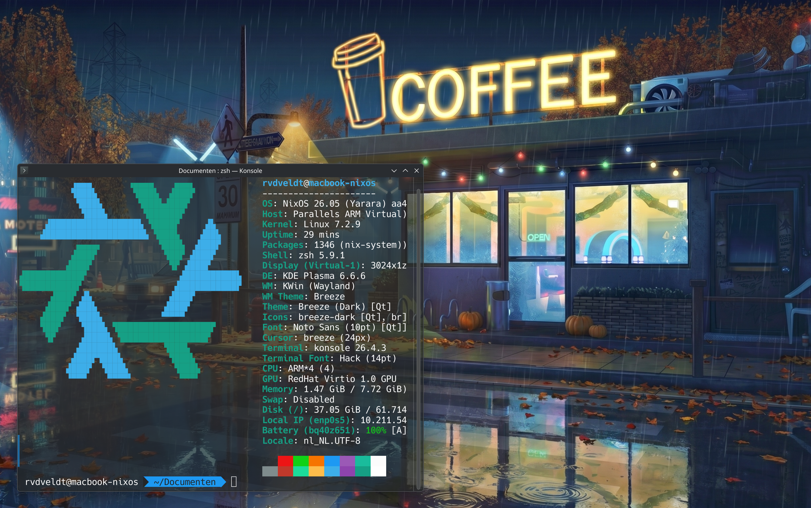

# NixOS Configurations
These are the configuration files of all NixOS devices and Virtual Machines. Currently installed Linux Kernel 7.2.9. Standard LTS is Linux Kernel 6.18 (latest).

## Current Devices

### Macbook Pro M1 Virtual Machine
This installation is a KDE Plasma GUI version using Parallels Desktop on my Macbook Pro M1. The 
configuration files are in the subfolder mbp-m1-nixos, including the relevant README.md

  

### Asus Republic of Gamers Laptop
This used to be a Windows laptop, which got really sluggish and unuseable. The hardware configuration
is a bit different, a second harddrive (/dev/sda1) is mounted as /home for all user data.

## Synology
As an extra backup, the repository is pushed to my Synology NAS. Therefore I needed a .gitignore file to leave some specific NAS files from the repository.
